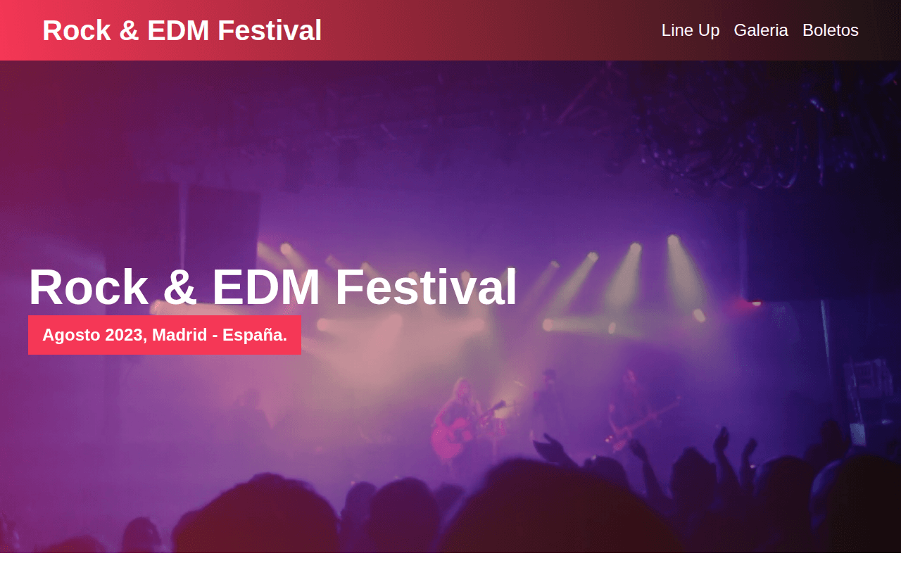
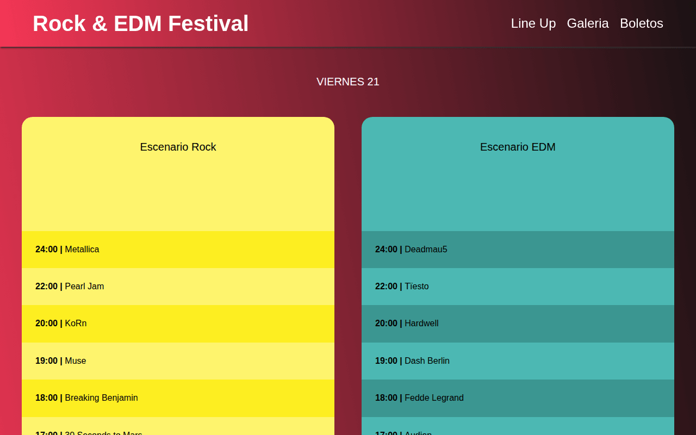
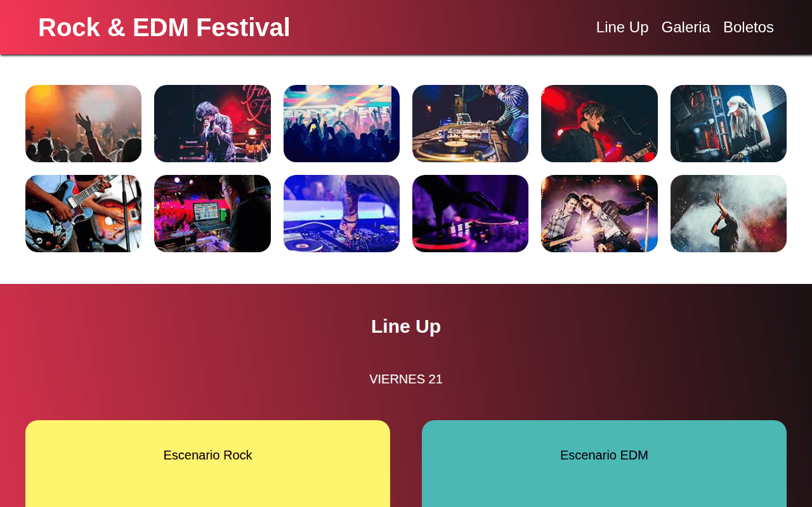

# Festival de Música · Landing page responsive

> **Proyecto de formación.** Ejercicio del curso *Desarrollo Web Completo* de
> Juan Pablo De la Torre Valdez ([Código Con Juan](https://codigoconjuan.com)),
> que hice como formación profesional para mi trabajo.


**Demo:** <https://ricardo-mendez-saoprojects.github.io/FestivalMusica/>

Landing de un festival de rock y música electrónica: cabecera con vídeo, presentación,
cartel por días y escenarios, galería de fotos y precios de las entradas.

## Funcionalidades

- Vídeo de fondo en la cabecera y navegación que se fija al hacer scroll.
- Desplazamiento suave a cada sección desde el menú.
- Galería generada con JavaScript que abre cada foto a tamaño grande en un modal.
- Imágenes en AVIF, WebP y JPG con `<picture>` para servir el formato más ligero.
- Diseño responsive, *mobile first*.

## Capturas

| Cabecera | Line up | Galería |
|---|---|---|
|  |  |  |

## Stack

- HTML5, CSS compilado desde Sass (variables, mixins y parciales por sección) y JavaScript
  sin librerías.
- Gulp para compilar Sass, minificar JS y generar las versiones WebP y AVIF de las imágenes.

> El repositorio contiene solo el resultado compilado (`build/`). Las fuentes Sass no están
> versionadas; sus parciales aparecen listados en `build/css/app.css.map`.

## Cómo ejecutarlo en local

Es un sitio estático: basta con servir la carpeta.

```bash
git clone git@github.com:ricardo-mendez-saoprojects/FestivalMusica.git
cd FestivalMusica
python3 -m http.server 8000      # o abre index.html directamente
```

## Estructura

```
├── index.html
├── build/
│   ├── css/      app.css (+ sourcemap)
│   ├── img/      imágenes en AVIF, WebP y JPG/PNG; thumb/ y grande/ para la galería
│   └── js/       app.js (+ sourcemap)
└── video/        vídeo de la cabecera
```

## Créditos

Ejercicio del curso *Desarrollo Web Completo* de Juan Pablo De la Torre Valdez
([Código Con Juan](https://codigoconjuan.com)). El diseño y el contenido son del curso.

<details>
<summary><strong>English</strong></summary>

# Music Festival · Responsive landing page

> **Learning project.** Exercise from the *Desarrollo Web Completo* course by
> Juan Pablo De la Torre Valdez ([Código Con Juan](https://codigoconjuan.com)),
> taken as professional training for my job.

**Demo:** <https://ricardo-mendez-saoprojects.github.io/FestivalMusica/>

Landing page for a rock and electronic music festival: video header, introduction, line-up
by day and stage, photo gallery and ticket prices.

## Features

- Background video in the header and a navigation bar that sticks on scroll.
- Smooth scrolling to each section from the menu.
- JavaScript-generated gallery that opens each photo full size in a modal.
- AVIF, WebP and JPG images served through `<picture>`.
- Responsive, mobile-first layout.

## Screenshots

See the table above.

## Stack

- HTML5, CSS compiled from Sass (variables, mixins and per-section partials) and vanilla
  JavaScript.
- Gulp to compile Sass, minify JS and generate WebP and AVIF images.

> The repository only contains the compiled output (`build/`). The Sass sources are not
> versioned; their partials are listed in `build/css/app.css.map`.

## Running locally

It is a static site: just serve the folder.

```bash
git clone git@github.com:ricardo-mendez-saoprojects/FestivalMusica.git
cd FestivalMusica
python3 -m http.server 8000      # or open index.html directly
```

## Structure

See the tree above: `index.html`, `build/` (css, img, js) and `video/`.

## Credits

Exercise from the *Desarrollo Web Completo* course by Juan Pablo De la Torre Valdez
([Código Con Juan](https://codigoconjuan.com)). Design and content come from the course.

</details>
